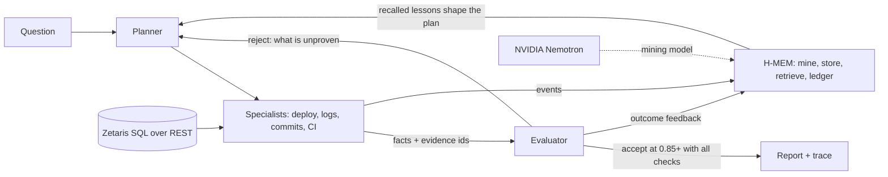

# Build-failure detective (Open Agent Hackathon 2026)

Track: **The Agent That Can Explain Why**

**User:** a small dev team with no dedicated ops person.
**Problem:** a production deploy fails and nobody knows which change broke it. People guess, roll back, and lose hours.
**What this does:** an agent that investigates the failure across deploy history, logs, commits, CI and the production environment, then reports the likely cause with the evidence behind it, what it ruled out, and how confident it is.

## Run it (no credentials, no dependencies beyond Python 3.10+)

```bash
SAMPLE_MODE=true python3 -m agent.main
python3 -m unittest -v
```

Outputs land in `outputs/report.md` and `outputs/trace.jsonl`, with memory audit logs in `outputs/logs/`. Saved examples are in `sample_outputs/` (three sessions against one memory; regenerate with `python3 scripts/demo_memory.py`).

## Architecture



## Run it live (Zetaris + Nemotron)

Set `SAMPLE_MODE=false` and fill `.env` (see `.env.example`), with Zetaris running locally, then `python3 -m agent.main`. Proof runs are saved in `sample_outputs/live-run-1` (cold start) and `sample_outputs/live-run-2` (the lesson from run 1 is recalled, 1 round instead of 4).

## Docker

```bash
docker build -t build-detective .
docker run --rm build-detective            # sample mode, no credentials
```

## How it works

- **Planner** decides which specialist to run next based on what the evaluator says is still unproven.
- **Specialists** (deploy, logs, commits, CI) each read one source and return facts with evidence ids like `log:d-102:7`.
- **Evaluator** scores the hypothesis from four checks (error signature in logs, commit introduces it, production lacks it, CI explains the green build). It rejects until everything is verified, which forces the planner to retry and branch. If evidence contradicts the suspect, the agent says "inconclusive" instead of guessing.
- **Memory (H-MEM)** keeps tiered memory across runs. A lesson learned in one incident is retrieved in a different incident and lets the planner run the likely checks together. The evaluator still verifies every check from evidence, and the outcome is fed back to adjust the lesson's confidence.
- **Trace** logs every step as JSONL, so you can replay how the answer was reached.

Nothing is hardcoded to the sample answer. The tests move the root cause to a different commit and remove the key evidence, and the agent follows the data.

## Sample data

`sample_data/` is a synthetic project with one planted root cause (a config variable renamed in code but not in production) and decoys (an unrelated email retry change that logs warnings, a lodash bump, a README edit).

## Status and sponsor technology

Honest status as of the last commit:

| Component | Status |
|---|---|
| Agent loop, trace, tests, SAMPLE_MODE | Working |
| Zetaris as the data layer | Integrated and verified live: the agent reads commits, deploys, CI runs, logs and prod env through SQL over the Zetaris REST API (`SAMPLE_MODE=false`). Offline tests use a fake runner; the live test is opt-in (`RUN_LIVE_ZETARIS=1`). |
| Meterless engine (H-MEM) | Implemented in Python from the H-MEM Agent Engine reference architecture, in `agent/hmem/`: tiered store, runtime-event mining (with a no-model fallback), hybrid retrieval with reinjection payload, JSONL trust ledger, feedback adaptation, warm start with forgetting curve. Not implemented: dreaming, sleep/consolidation, conflict resolution. No Meterless runtime token is used; memory is local. |
| NVIDIA Nemotron | Integrated and verified live (`nvidia/nemotron-3.5-bolt-e4b` by default, override with `NVIDIA_MODEL`). It acts as the H-MEM mining model that turns each specialist result into durable memories. If the call fails or no key is set, mining falls back to plain summaries. It never decides the diagnosis; the evaluator does. |

Secrets go in `.env` (see `.env.example`). `.env` is gitignored.

## Pre-existing work

None. Everything in this repo was created during the build window.
