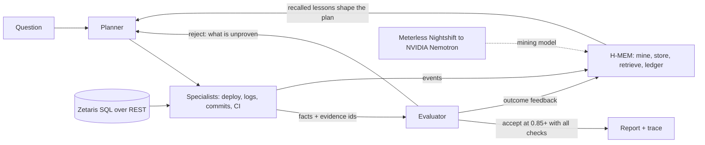

# Build-failure detective (Open Agent Hackathon 2026)

Track: **The Agent That Can Explain Why**

**User:** a small dev team with no dedicated ops person.
**Problem:** a production deploy fails and nobody knows which change broke it. People guess, roll back, and lose hours.
**What this does:** an agent that investigates the failure across deploy history, logs, commits, CI and the production environment, then reports the likely cause with the evidence behind it, what it ruled out, and how confident it is.

## Run it (no credentials, no dependencies beyond Python 3.10+)

```bash
SAMPLE_MODE=true python3 -m agent.main
python3 -m unittest -v
```

Outputs land in `outputs/report.md` and `outputs/trace.jsonl`, with memory audit logs in `outputs/logs/`. Saved examples are in `sample_outputs/` (three sessions against one memory; regenerate with `python3 scripts/demo_memory.py`).

## Architecture



## Run it live (Zetaris + Nemotron)

Set `SAMPLE_MODE=false` and fill `.env` (see `.env.example`), with Zetaris running locally, then `python3 -m agent.main`. Proof runs are saved in `sample_outputs/live-run-1` (cold start, 4 rounds) and `live-run-2` (the lesson from run 1 is recalled, 1 round). Both used Zetaris for data and Nemotron through Nightshift for memory mining.

## Docker

```bash
docker build -t build-detective .
docker run --rm build-detective            # sample mode, no credentials
```

## How it works

- **Planner** decides which specialist to run next based on what the evaluator says is still unproven.
- **Specialists** (deploy, logs, commits, CI) each read one source and return facts with evidence ids like `log:d-102:7`.
- **Evaluator** scores the hypothesis from four checks (error signature in logs, commit introduces it, production lacks it, CI explains the green build). It rejects until everything is verified, which forces the planner to retry and branch. If evidence contradicts the suspect, the agent says "inconclusive" instead of guessing.
- **Memory (H-MEM)** keeps tiered memory across runs. A lesson learned in one incident is retrieved in a different incident and lets the planner run the likely checks together. The evaluator still verifies every check from evidence, and the outcome is fed back to adjust the lesson's confidence.
- **Trace** logs every step as JSONL, so you can replay how the answer was reached.

Nothing is hardcoded to the sample answer. The tests move the root cause to a different commit and remove the key evidence, and the agent follows the data.

## Sample data

`sample_data/` is a synthetic project with one planted root cause (a config variable renamed in code but not in production) and decoys (an unrelated email retry change that logs warnings, a lodash bump, a README edit).

## Status and sponsor technology

Honest status as of the last commit:

| Component | Status |
|---|---|
| Agent loop, trace, tests, SAMPLE_MODE | Working |
| Zetaris as the data layer | Integrated and verified live: the agent reads commits, deploys, CI runs, logs and prod env through SQL over the Zetaris REST API (`SAMPLE_MODE=false`). Offline tests use a fake runner; the live test is opt-in (`RUN_LIVE_ZETARIS=1`). |
| Meterless engine (H-MEM) | Implemented in Python from the H-MEM Agent Engine reference architecture, in `agent/hmem/`: tiered store, runtime-event mining (with a no-model fallback), hybrid retrieval with reinjection payload, JSONL trust ledger, feedback adaptation, warm start with forgetting curve. Not implemented: dreaming, sleep/consolidation, conflict resolution. No Meterless runtime token is used; memory is local. |
| Meterless Nightshift + NVIDIA Nemotron | Integrated and verified live. All model calls go through Nightshift (`agent/nightshift.py`, OpenAI-compatible endpoint, default `http://localhost:8088/v1`). Nightshift routes to NVIDIA `nemotron-3-ultra-550b-a55b`, and the trace logs which model answered each request (`sample_outputs/live-run-*/trace.jsonl`, fields `model` and `provider`). The NVIDIA key lives in Nightshift's Providers tab, not in this project. Nightshift is optional at runtime: if it is off, mining falls back to plain summaries. |

Secrets go in `.env` (see `.env.example`). `.env` is gitignored.

## Pre-existing work

None. Everything in this repo was created during the build window.

## Sponsor technology explanation

**Zetaris (data layer).** Commits, deploys, CI runs, logs and production env live as REST tables in a local Zetaris instance (Lightning SQL over GitHub-hosted JSON). The agent reads everything with SQL through the Zetaris REST API (`agent/zetaris_source.py`); the exact queries are logged in the trace. Without Zetaris, `SAMPLE_MODE=true` reads the same data from `sample_data/`.

**Meterless H-MEM engine.** Implemented in `agent/hmem/` from the H-MEM Agent Engine reference: tiered memory (short-term, working, long-term), mining of runtime events into memories, hybrid retrieval with a reinjection payload, a JSONL trust ledger, feedback adaptation and warm start with a forgetting curve. What it does here: after the first failure is investigated the agent saves a lesson; in a later, different incident the lesson is retrieved, the planner runs the likely checks together, and the outcome is fed back to raise or lower the lesson's confidence. Test: `tests/test_hmem.py` (cold start saves a lesson, the lesson carries to a different incident, confidence grows with helpful feedback, a contradicting incident marks the lesson wrong and is not confirmed, ledger and retrieval trace are written, unrelated queries retrieve nothing). Not implemented: dreaming, consolidation, conflict resolution.

**Meterless Nightshift (AI provider).** The only AI calls (memory mining) go through Nightshift's OpenAI-compatible endpoint with the Runtime API key (`METERLESS_BASE_URL`, `METERLESS_RUNTIME_TOKEN`). The model that answered each request is recorded in the trace.

**NVIDIA.** Nemotron models are connected inside Nightshift (Providers tab). Live runs used `nvidia/nemotron-3-ultra-550b-a55b`, visible per request in the trace. Nemotron does not decide the diagnosis; it turns specialist output into durable memories, and the evaluator verifies every conclusion from evidence.

**What is unique.** Memory shapes the plan but never lowers the evidence bar: a recalled lesson can only reorder work, and the evaluator still requires every check to pass, so a wrong memory gets marked wrong instead of producing a confident wrong answer.

## Docker with Zetaris and Nightshift

Inside a container `localhost` is the container. For live mode use `host.docker.internal`:
`docker run --rm --env-file .env -e SAMPLE_MODE=false -e METERLESS_BASE_URL=http://host.docker.internal:8088/v1 -e ZETARIS_REST_URL=http://host.docker.internal:8888/api/v1.0 build-detective`

## Does it generalise? (evaluation)

`python3 scripts/evaluate.py` runs the agent on six different incidents built from the same data layer and checks the verdict on each. Three are real root causes in different commits and of two kinds (a required setting production lacks, and a package upgrade production never received); three are cases where the right answer is to refuse to name a cause (an infrastructure outage no commit explains, and suspects that production contradicts). Results are in `sample_outputs/evaluation.md`, and each scenario's input and output is in `scenarios/` and `sample_outputs/scenario-*`.

## Explanations you can check

After the evaluator decides, Nemotron (through Nightshift) writes a plain-English explanation. It cannot change the verdict. Every point must cite an evidence id the agent collected, and any output that cites an unknown id, invents a commit or setting name, or overclaims on an inconclusive verdict is rejected and replaced by a template. The report says which one you are reading and which model wrote it.

## The web app

The UI uses Motion (MIT, vendored in `agent/web/vendor/`, so it works offline) for the card tilt, cursor spotlight, staggered check pills and the confirmation burst. A three-step strip and hover tips explain each station for first-time viewers.

`python3 -m agent.server` then open http://localhost:8000. Pick an incident, press Investigate, and watch the agent's steps, verdict, evidence ids and the cited explanation. Run "Renamed setting breaks production" and then "Same failure, different names" to see memory cut the work from four rounds to one. With `SAMPLE_MODE=false` a "Live data from Zetaris" option appears.

## Stress test

`python3 scripts/benchmark.py 400` generates 400 random incidents (random number of commits, culprit position, decoy commits including near-misses that require a different setting, noisy warnings, and four outcome types). Latest result in `sample_outputs/benchmark.md`: all 400 verdicts correct, 242 of 242 real causes named correctly, 158 of 158 non-causes refused, zero false confirmations. These incidents are synthetic and generated by us from the same schema, so read this as a check on the agent's logic, not as a claim about real-world accuracy.

## Follow-up questions

After an investigation, the web app lets you ask things like "why was 77bb88c ruled out?" or "how sure are you?". Answers come only from verified facts, carry evidence ids, and a model's answer is rejected if it cites something unknown or invents an identifier.

A ready-to-use GitHub Actions workflow is in `docs/ci-workflow.yml.example` (copy it to `.github/workflows/test.yml`).

## Sample inputs and outputs

| Input (data) | Output (report and trace) | What it shows |
|---|---|---|
| `sample_data/` | `sample_outputs/scenario-planted/` | Renamed setting, CI green, production missing it |
| `scenarios/other-service-secret/` | `sample_outputs/scenario-other-service-secret/` | A different commit is the culprit |
| `scenarios/dependency-version-skew/` | `sample_outputs/scenario-dependency-version-skew/` | Package upgrade CI installed but production never got |
| `scenarios/infrastructure-outage/` | `sample_outputs/scenario-infrastructure-outage/` | No commit explains it, so the answer is inconclusive |
| `scenarios/contradicted-by-prod/` | `sample_outputs/scenario-contradicted-by-prod/` | The obvious suspect is already fixed in production |
| Live Zetaris data | `sample_outputs/live-run-1/`, `live-run-2/`, `live-run-3/` | Real runs through Zetaris, Nightshift and Nemotron; `trace.jsonl` logs the model for each request |
| Three sessions | `sample_outputs/session-1..3/` | Memory carrying over between incidents |

## Judging without live access

Sample mode is the baseline and needs no accounts, credentials or sign-in: `python3 -m agent.main` (or `python3 -m agent.server` for the web app). Everything above, including the evaluation, the stress test and the follow-up questions, runs in sample mode.

Live mode is shown in the demo video: a real request through Zetaris and Meterless Nightshift to NVIDIA Nemotron. We do not run a public gateway. Live mode needs your own local Zetaris and Nightshift (see "Run it live"), and `sample_outputs/live-run-*` hold the traces of real live runs, including which model handled each request. No tokens or secrets are in this repository.

## The 3D machine

The web app opens on a 3D model of the agent (procedural three.js, vendored in `agent/web/vendor/`, no network needed). Evidence packets ride a belt through Zetaris, the planner, four specialists, the evaluator gate and the explainer, with H-MEM beside it. During an investigation, an amber packet follows the agent from station to station and the evaluator gate flashes red on a rejection and green on acceptance.
